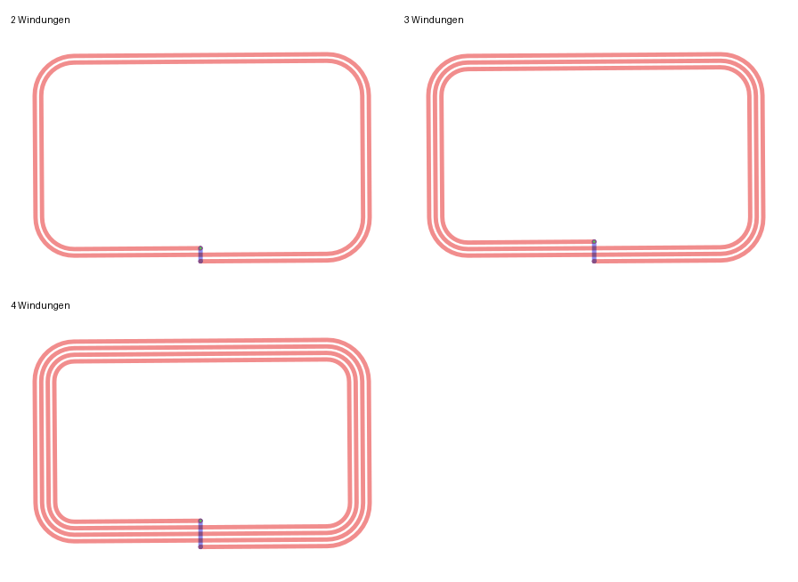

# Antennen-Footprints RFID-Board

Kandidaten für die 13,56-MHz-Leseschleife, erzeugt mit
[KiCoil](https://jaseg.de/projects/kicoil). `./generate.sh` baut alle neu.

## Geometrie

Freie Fläche **80 × 50 mm**, abzüglich 0,5 mm Randabstand und halber
Leiterbreite bleibt als Kontur (Mittellinie der äußersten Windung)
**78 × 48 mm**, Eckradius 10. Kupfer außen 78,4 × 48,1 mm.

`AREA_W`/`AREA_H`/`EDGE`/`RADIUS` in `generate.sh` sind die einzige Stelle,
an der das steht.

Die Schleife sitzt auf dem RFID-Board mit 4 Lagen. Der Keepout gilt auf
**allen vier**, die GND- und Versorgungsflächen auf L2/L3 sind dort
ausgespart.

Das Format folgt der Karte: eine ID-1-Karte (85,6 × 54 mm) trägt ihre Spule
rund 78 × 46 mm innerhalb des Kartenrands.

## Varianten

Gemeinsam: **1,0 mm Leiterbreite, 0,5 mm Abstand, einlagig, 3 mm
Keepout-Rand**. Freie Größe ist nur die Windungszahl.

| Footprint | Wdg | Ringbreite | Innenöffnung | L | R @ 13,56 MHz | fres | Q0 |
|---|---:|---:|---:|---:|---:|---:|---:|
| `NFC_Loop_80x50_2T` | 2 | 3,0 mm | 72 × 42 mm | 751 nH | 0,72 Ω | 130 MHz | 89 |
| `NFC_Loop_80x50_3T` | 3 | 4,5 mm | 69 × 39 mm | 1430 nH | 1,08 Ω | 85 MHz | 113 |
| `NFC_Loop_80x50_4T` | 4 | 6,0 mm | 66 × 36 mm | 2241 nH | 1,44 Ω | 64 MHz | 133 |

L, R und fres aus dem **NFC Antenna Tool von NXP** (Reader, FR4,
35 µm Kupfer, 1,6 mm, Er 4,3). Q0 = ωL/R; der Dämpfungswiderstand
zieht sie auf 20.

Das Feld hängt nur mit N^0,17 von der Windungszahl ab, die Auswahl
entscheidet also fres und das Transformationsverhältnis, nicht die
Reichweite. 5 und 6 Windungen entfallen, sie lägen bei 3,1 und 4,0 µH.

**KiCoils Induktivität im `descr`-Feld der Footprints ist falsch** — für
diese Geometrie durchgehend Faktor 2,37 zu niedrig (313 / 605 / 946 nH).
Betroffen ist nur die Zahl, nicht die Geometrie.

**Erwartungswert für die Messung: 1,4 bis 2,4 µH.** Ausgelegt wird mit den
1430 nH des Tools; die Abschätzformel im Datenblatt (14.1.4) liefert
2400 nH. Die Anpassung muss die Spanne auffangen.

## Anschlüsse

Abgriff in der **Mitte der unteren Kante**, (0, +24) ab Footprint-Ursprung.
`START` in `generate.sh` verschiebt ihn; `shape_svg.py --start` kennt
`bottom`, `left`, `right`, `top` und die Eckvarianten, die auf der geraden
Kante am Beginn des Eckradius sitzen.

| Pad | Art | Bedeutung |
|---|---|---|
| `1` | SMD auf F.Cu | äußeres Ende der Schleife |
| `2` | SMD auf B.Cu, **gleiche Koordinate wie Pad 1** | inneres Ende |
| `NC` | Durchkontaktierung | Übergang auf die Rückseite, um die Ringbreite nach innen versetzt (3 Wdg: (0, +19,5)) |

Die Spirale läuft auf F.Cu von außen nach innen, fällt über die
Durchkontaktierung auf B.Cu und kehrt dort zum Einspeisepunkt zurück. Dieser
Rückweg ist das einzige Kupfer unter der Schleife. Fürs Matching: ein Zweig
kommt von vorn an Pad 1, der andere von hinten an Pad 2, beide am selben
Punkt.

## Matching

Synthese des NXP-Tools für **3 Windungen**, Reader **CLRC663**, Q = 20,
Zielimpedanz 20 Ω, EMV-Eckfrequenz 21 MHz. Jeder Wert kommt **zweimal** vor,
einmal je Zweig.

| Position | Rechenwert | Bestückung | Anmerkung |
|---|---:|---|---|
| L₀ | 470 nH | 470 nH, **300 mA** ohne Sättigung | AN11019 |
| C₀ | 122,2 pF | 120 pF C0G, 50 V | zulässig 120…200 pF |
| C₁ | 47,0 pF | 47 pF C0G, 100 V | Serie |
| C₂ | 124,9 pF | 120 pF ∥ 4,7 pF C0G, 100 V | parallel, **Trimmstelle** |
| RS | 2,51 Ω | 2,4 Ω ±1 %, ≥ 0,25 W | Q damit 20,7 |

- **C0G/NP0, kein X7R** (AN11019). Nur C3 im Empfangszweig darf X7R sein.
- **Toleranz unter ±1 %** für die Anpassbauteile.
- Beide Zweige mit **demselben Bauteil**; Symmetrie vor Einzelgenauigkeit.
- RS führt den vollen Antennenstrom: nicht drahtgewickelt.
- C₁, C₂ und RS bekommen je **zwei parallele Plätze**, wie das
  Demoboard in AN11019 Fig. 17. Umbestücken statt neu fertigen.

### Empfangszweig

RXP (12) und RXN (13) bilden einen **differentiellen Empfänger**, ein Zweig
je Antennenseite. Werte aus AN11019 Fig. 17:

| Position | Wert | Funktion |
|---|---|---|
| R1A / R1B | **12 kΩ** | Serienwiderstand vom EMV-Filter-Knoten |
| C3A / C3B | **1 nF** | Koppelkondensator, X7R genügt |
| RV1 / RV2 | **1 kΩ** | gegen VMID |
| Cvmid | **100 nF** X7R | VMID gegen GND, dicht an Pin 14 |

Reihenfolge je Zweig: Knoten hinter L₀ → R1 → C3 → RXP bzw. RXN, RV vom Pin
gegen VMID. Cvmid ist nirgends beziffert, 100 nF ist der Wert der
Bauteilfamilie.

Abgleich über den **Serienwiderstand**: zulässig 7 bis 15 kΩ, Startwert
12 kΩ. Spannung an RXP/RXN mit Aktivtastkopf (< 3 pF) messen, Spitzenwert
**1,2 bis 1,7 V, optimal 1,5 V**, mit Referenzkarte im Feld. Zu hoch →
größer, zu niedrig → kleiner.

Die Dokumente benennen dieselben Bauteile verschieden:

| | Serien-R 12 k | gegen VMID 1 k | Koppel-C 1 n |
|---|---|---|---|
| AN11019 Fig. 17 | R1A / R1B | RV1 / RV2 | C3A / C3B |
| AN11019 Text 4.4.1 | R2A / R2B | — | — |
| Datenblatt Fig. 36 | R2 / R4 | R1 / R3 | CRXN / CRXP |

## Was das Werkzeug nicht kann

KiCoils SVG-Import liest nur das erste `<path>` und darin nur
`M x y L x y … Z` — keine Bögen, keine `H`/`V`, keine Kommas. `shape_svg.py`
löst runde Konturen deshalb vorher in Strecken auf (Pfeilhöhe 0,03 mm) und
legt den Abgriff ans **Ende** des Pfades, wo KiCoil ihn erwartet.

`--annular-width` muss `Windungen × (Leiterbreite + Abstand)` sein, sonst
bricht der Lauf mit „Actual clearance … is lower than the given clearance"
ab; `generate.sh` rechnet das. Ab 7 Windungen passt der Ring nicht mehr in
die 48 mm Höhe.

Die Warnung „Polygon looks not centered" ist ein Fehler in KiCoils
Bounding-Box-Prüfung. Der Schwerpunkt ist (0, 0), verschoben wird nichts.

## Umgebung

KiCoil fordert Python ≥ 3.13, KiCads Interpreter ist 3.9. `generate.sh` legt
deshalb beim ersten Aufruf `~/.cache/kicoil-venv` an. Das Vergleichsbild
braucht `rsvg-convert` (Homebrew: `librsvg`).

## Offen

- Windungszahl: 3 vorgeschlagen, nicht entschieden.
- Abstimmung gilt erst im fertigen Gerät: das RFID-Board sitzt im Deckel,
  das I/O-Board in der unteren Schale, einige Zentimeter unter der Antenne.
- Matching aus gemessenem L und R nachrechnen. Maßgeblich ist **AN11019**
  für CLRC663/MFRC630/MFRC631/SLRC610, nicht AN1445.
