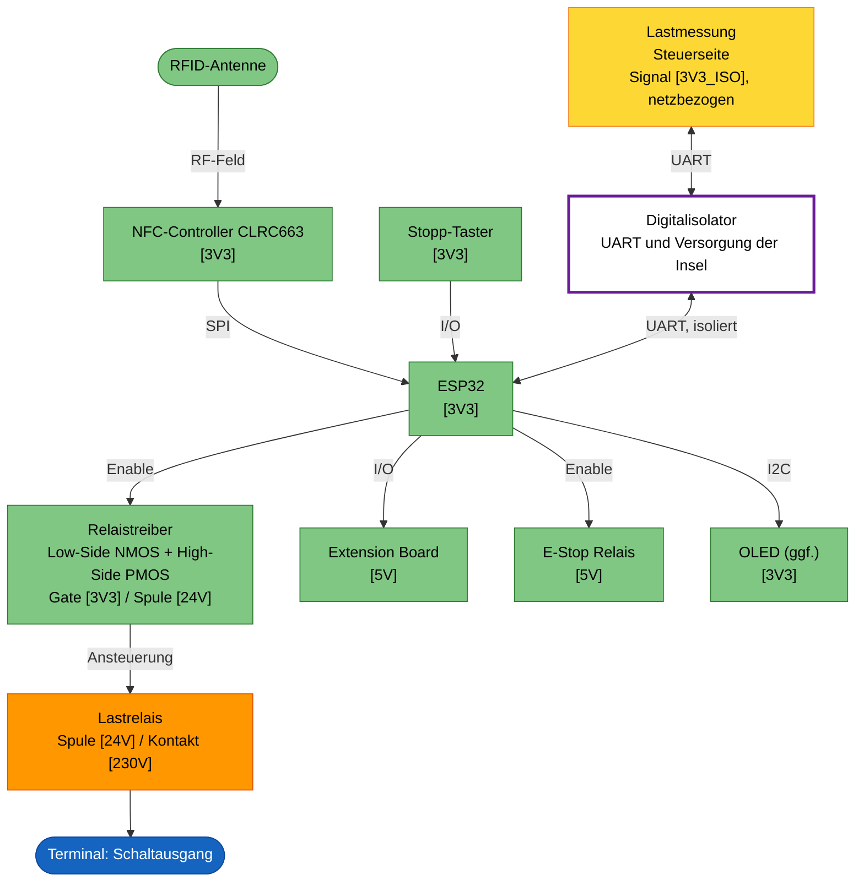

# Machine Node / RFID_BOX

> **Sicherheit geht vor Kosten, Baugröße und Bauteilzahl.** Das Gerät
> schaltet Netzspannung in einer Werkstatt, in der ungeschulte Personen
> daneben stehen. Wo Ziele kollidieren, gewinnt die Sicherheit.
>
> Vier Festlegungen sind bindend und werden nicht aufgeweicht:
>
> - Die Barriere Netz ↔ SELV beträgt **8 mm Luft- und Kriechstrecke** und
>   wird nicht auf den Normwert von 5 mm reduziert. Maßgeblich sind die
>   Bauteile, die sie queren, nicht das Minimum der Norm.
> - Bauteile über der Barriere brauchen **verstärkte oder doppelte
>   Isolierung** bei 250 V Arbeitsspannung. Eine hohe Prüfspannung in kV
>   allein genügt nicht — sie sagt über die Isolationsklasse nichts aus.
> - **Ein Einzelfehler darf nicht nach außen wirken.** Neue Schaltungsteile
>   werden gegen die [FMEA](FMEA.md) geprüft, bevor sie ins Layout gehen.
> - **Beim geöffneten Gerät ist nichts Netzführendes berührbar.** Feste
>   Abdeckplatten über dem I/O-Board geben nur die Feldterminals und den
>   Sicherungshalter frei. Das RFID-Board führt kein 230 V und darf
>   angefasst werden.
>
> Breiten, Abstände und Domänen stehen in
> [Layoutregeln.md](Layoutregeln.md), die Anforderungen in
> [Anforderungen.md](Anforderungen.md). Wo das Gerät teuer ist und was eine
> Alternative kosten würde, führt [Kostenoptimierung.md](Kostenoptimierung.md)
> mit — keine der Positionen dort hebt eine der vier Festlegungen auf.

## Einleitung

Dies ist der **RFID Node**: ein kompaktes Steuergerät, das elektrische
Geräte und Maschinen in der Werkstatt (z.B. Standfräse, Drehmaschine, FKS)
per RFID-Karte freischaltet. Er prüft die Karte einer Nutzerin oder eines
Nutzers gegen easyVerwaltung, gibt bei gültiger Berechtigung die Maschine
frei und schaltet sie beim Stopp oder bei Kartenentzug wieder ab.

Technisch besteht der Node aus zwei Platinen — I/O-Board mit Netzteil und
Schaltausgang, RFID-Board mit Controller, Bedienoberfläche und
RFID-Frontend — ergänzt um optionale Erweiterungsboards für Maschinen mit
zusätzlichem Bedarf.

## Aufbau

Das Gehäuse ist 3D-gedruckt und staubdicht ausgeführt. Display und
LED-Streifen sind von aussen sichtbar und durch eine Plexiglasscheibe
geschützt; der Streifen selbst sitzt innerhalb des Gehäuses. Der Stopp-Knopf
ist von aussen erreichbar.

Das Display sitzt nicht auf der Platine, sondern in einem eigenen
3D-gedruckten Träger, der von innen hinter die Plexiglasscheibe geklippt
wird. Die Verbindung zum RFID-Board läuft über das FPC des Displays.

Die Mechanik — Gehäuse, Display-Träger, Abdeckplatten — lebt in Fusion, nicht
in diesem Repo. Von dort kommen auch die Platinenumrisse als DXF
(`PCB_outline/`).

Die beiden Platinen sitzen in verschiedenen Gehäusehälften: das
**RFID-Board am Deckel**, das **I/O-Board an der unteren Schale**. Verbunden
werden sie über ein **Kabel** — für einen Board-to-Board-Stecker ist der
Abstand zu groß. Der Deckel hängt beim Öffnen damit am Kabel.

Alle Kabel werden einseitig über Kabeldurchführungen ins Gehäuse geführt,
von links nach rechts: Netz-Eingang 230 V, Schaltausgang (geschaltete 230 V
oder Steuerleitung für ein externes Schütz), optionale Notaus-Schleife,
optionales Extension-I/O. Nicht verwendete Durchführungen werden
verschlossen.

### Berührschutz

Das Gerät wird im Servicefall geöffnet, während es unter Umständen noch am
Netz hängt. Deshalb:

- Über dem I/O-Board sitzen **fest installierte, 3D-gedruckte
  Abdeckplatten**. Sie geben nur die Feldterminals und den Sicherungshalter
  frei — beide sind berührsichere Bauformen (WAGO Hebelklemme, WR-FSH mit
  Shocksafe PC2/IP20). Alles andere Netzführende bleibt abgedeckt.
- Die Platten sind kein Deckel, der beim Öffnen mitkommt: sie bleiben am
  Board bzw. am Gehäuseunterteil und lassen sich nur mit Werkzeug lösen.
- **Das RFID-Board führt kein 230 V** und darf im geöffneten Zustand
  berührt werden. Das ist eine bindende Randbedingung — es darf kein
  netzführendes Netz auf dieses Board wandern.

Alle Boards werden **lackiert**, damit Sägemehl und Feuchtigkeit über die
Lebensdauer keine Kriechpfade bilden. Vom Lack ausgenommen bleiben
Feldterminals, Sicherungskontakte und die Steckverbinder. Der Lack
ersetzt keine Abstände: Kriech- und Luftstrecken werden bemessen, als wäre
kein Lack vorhanden.

## Elektronik

Zwei Leiterplatten, in verschiedenen Gehäusehälften:

- **RFID-Board (im Deckel):** ESP32-S3, NFC-Controller CLRC663 mit der
  RFID-Antenne, Display, LED-Streifen, Buzzer, Stopp-Taster und eine
  USB-C-Buchse für Erstprogrammierung und Debug. MCU- und RFID-Teil lagen früher getrennt
  und sind zusammengelegt.
- **I/O-Board (in der unteren Schale):** 230-V-Netz, Schaltausgang und die
  Extension-Header.
  Hiervon gibt es **zwei getrennte Boards mit eigenem Layout**, von denen
  pro Gerät genau eines bestückt wird:
  - **I/O-Board 230V** — Lastrelais und Lastmessung zum direkten Schalten
    von Lasten bis 8 A.
  - **I/O-Board 24V** — potentialfreier Kontakt für ein externes Schütz.
    Ohne Lastpfad und Lastmessung, dadurch deutlich einfacher und ohne
    Bedarf an 70 µm Kupfer.

  Beide haben denselben Formfaktor und denselben Kabelstecker zum
  RFID-Board.

Dazu kommen zwei optionale, steckbare Erweiterungsboards auf dem I/O-Board:

- **Extension Board:** generisches Zusatzboard mit zwei Bestückvarianten —
  **NAMUR** (zwei optoisolierte Ausgänge, ein galvanisch getrennter Eingang)
  oder **Digital-I/O** (noch nicht spezifiziert). Ein Node trägt höchstens
  eine Variante.
- **E-Stop Extension Board:** Relais (24 V / 100 mA), dessen Kontakt in die
  Notaus-/Interlock-Schleife oder Bremsversorgung der Maschine eingeschleift
  wird. Fail-safe: stromlos = Schleife unterbrochen. Es öffnet bei Stopp
  oder Kartenentzug sofort, während die Hauptversorgung erst nach der
  Nachlaufzeit trennt.

## Energieversorgung

Die gesamte Versorgung kommt aus dem Netz-Eingang 230 V auf dem I/O-Board
und teilt sich dort in zwei Pfade:

- **Lastpfad (nur I/O-Board 230V):** Netz-Eingang → Ausgangssicherung (F300)
  → Lastrelais (K300) → Schaltausgang. Der Shunt (R300) liegt im
  **N-Rückweg vor dem Relais**, damit die Messung unabhängig vom
  Schaltzustand betriebsbereit bleibt. K300 trennt L und N gemeinsam, weil
  die N/L-Zuordnung an der Werkstatt-Steckdose nicht garantiert eindeutig
  ist.
- **Steuerpfad:** Netz-Eingang → Sicherung F302 → Gleichtaktdrossel (L300) →
  Y-Kondensatorpaar (C309/C310, Mittelabgriff an PE) → isoliertes
  AC/DC-Modul (U301, 24 V) → Regler auf 5 V (U306). Über das Kabel geht nur
  die 5-V-Schiene zum RFID-Board; **die 3,3 V erzeugt jede Platine selbst** —
  U307 auf dem I/O-Board für die Eingangsseite des Isolators, U103 auf dem
  MCU-Board für ESP32, NFC-Frontend und Display. Der DC-DC im Isolator zieht
  seinen Strom damit lokal und nicht über 30 cm Kabel. Die 24-V-Schiene
  versorgt die Relaisspule und bleibt auf dem I/O-Board; zum MCU-Board geht
  statt der Schiene nur ein Teilersignal zur Überwachung. LED-Leiste und
  Buzzer laufen direkt auf 5 V.

Die **Lastmessung** liegt auf Netzpotential. Versorgung und UART laufen über
den Digitalisolator U300 (ISOW7721) mit integriertem DC-DC-Wandler, gespeist
aus der SELV-Seite — die Insel führt keinen eigenen Netzzweig. Über `ISO_EN`
nimmt die Firmware der Insel die Versorgung und startet das Mess-IC U302 neu.

Die Erweiterungsboards stecken auf dem I/O-Board und werden aus dem
Steuerpfad versorgt;
ihre Feldseite bleibt galvanisch getrennt und wird extern gespeist.

PE wird unverändert vom Netz-Eingang zum Schaltausgang durchgeschleift und
trägt den Mittelabgriff von C309/C310. Das Gehäuse ist Kunststoff, es gibt
keine Gehäusemasse.

**Sicherungen.** Die Lastausgangssicherung (F300) ist gesockelt und nach dem
Öffnen des Gehäuses ohne Löten tauschbar; eine Ersatzsicherung wird im
Gehäuse mitgeführt. Die Gerätesicherung (F302) ist als dokumentierte
Ausnahme fest verlötet (siehe [Anforderungen.md](Anforderungen.md), S5). Vor
F302 liegt R323, ein Sicherungswiderstand mit 10 Ω, der den Kurzschlussstrom
im Steuerzweig auf rund 25 A begrenzt — unter das Ausschaltvermögen von 35 A
der MRT.

**EMV.** Am Netz-Eingang liegen RV300 als Überspannungsschutz und C300 als
X2-Kondensator; eine Entladekette aus drei Widerständen bringt die
Steckerstifte in 0,17 s unter 60 V. Das Gleichtaktfilter aus L300 und
C309/C310 sitzt im Steuerzweig direkt vor U301, also an der Störquelle;
der Lastpfad trägt kein Filterbauteil. Auslegungspunkt ist 150 kHz bei 20 dB
Dämpfung. Drei Grenzen gelten dabei:

- Der Mittelabgriff nach PE ist zwingend — ohne ihn hat der Gleichtaktstrom
  im Kunststoffgehäuse keinen Rückweg, und die Drossel wirkt nur noch über
  ihre Streuinduktivität.
- Cy ist nach oben durch den Ableitstrom begrenzt; mehrere Nodes hängen am
  selben FI-Kreis.
- L nominal im Fenster 3–10 mH: nach unten setzt die Eckfrequenz die Grenze,
  nach oben die Eigenresonanz der Drossel.

**Bewusst nicht vorhanden:** eine Kontakt-Schutzbeschaltung am Lastrelais —
der Node ist Lastschalter, das Entkoppeln der Lastgeräte vom Netz ist nicht
seine Aufgabe. Und eine Einschaltstrombegrenzung im Lastpfad — den Anlauf
tragen die träge Ausgangssicherung und das Einschaltvermögen von K300
(30 A, AgCdO-Kontakte).

## Signalfluss

Der Signalfluss beginnt an der RFID-Karte und endet am Schaltausgang. Vier
Aussagen, die man kennen muss:

- Der Stopp-Taster wirkt **nur über die Firmware** auf den ESP32. Einen
  hardwareseitigen Bypass gibt es nicht, weder am E-Stop-Relais noch am
  Relaistreiber der Hauptversorgung.
- Das Enable bleibt vollständig auf der SELV-Seite. Die Relaisspule hängt an
  der isolierten 24-V-Schiene und wird von **zwei Schaltern in Reihe**
  geführt: Low-Side-NMOS (Q300) und High-Side-PMOS (Q301) an getrennten
  GPIOs. Beide gehen im Ruhezustand sicher auf, und ein durchlegierter
  Schalter lässt sich über den anderen noch abschalten.
- Die Hauptversorgung wird ausschliesslich vom ESP32 nach Ablauf der
  Nachlaufzeit abgeschaltet; das E-Stop-Relais öffnet sofort.
- Die Isolationsbarriere quert nur die UART der Lastmessung, über U300 — er
  führt zugleich die Versorgung der Insel hinüber.

Abgerundet = Terminal oder Eingabe, eckig = Funktionsblock. Grün =
Kleinspannung, orange = 230-V-führend, blau = 230-V-Terminal, gelb =
Signalpegel isoliert, Bauteil berührt aber die Netzseite, weiss mit
violettem Rahmen = Isolationsbarriere. `[…]` nennt den Signalpegel.

## Kernbauteile

Nur die Teile, die das Gerät bestimmen. Dazu die Sicherung: **im Servicefall
wird nur sie getauscht**, alles andere ist fest verlötet. Denkbar wäre noch
das Display, das über sein FPC steckbar ist.

Die vollständige Liste steht im Schaltplan und in
`ECAD/IO_Board/IO_Board.csv`, die Preise in `MyCSLib/KiCad/parts_db.json`.

| Funktion | Hersteller / Teilenummer | Warum dieser |
|---|---|---|
| Mikrocontroller | Espressif ESP32-S3-WROOM-1-N16R8 | WLAN/BLE, 16 MB Flash, 8 MB PSRAM |
| Lastrelais (K300) | TE Connectivity T92S11D12-24 | 2-polig (N+L), 30 A Einschaltvermögen, verstärkte Isolation Spule/Kontakt 8 mm / 9,5 mm / 4 kVrms. Bauhöhe 30,7 mm |
| Potentialfreier Kontakt, E-Stop (K2, K3) | Omron G5V-1-2 DC24 | 100 mA / 24 V, Spule 24 V |
| Display | EastRising ER-TFT020-3 | 2" IPS, 240×320, 4-Wire SPI. Ersetzt das DT010ATFT bei gleichem Bustyp, 5,3-fache aktive Fläche. Nacktes Panel, Anschluss über steckbares FPC 14-pol / 0,5 mm |
| Lastausgangssicherung + Ersatz (F301) | Bel Fuse 5HT 10-R | 10 A / 250 V träge, Keramik sandgefüllt, **Ausschaltvermögen 1500 A**. Die Glasrohrtype mit 100 A reicht nicht. Die VDE-Lizenz der Baureihe deckt nur 1–6,3 A, die 10 A laufen über UL, CSA und CCC |
| Gerätesicherung (F302) | Bel Fuse MRT 500-BULK | 500 mA / 250 V träge, IEC 60127-3. Fest verlötet, dokumentierte Ausnahme zu S5 |

## TODO

- RV300 liegt vor F300 und F302 und ist damit ungesichert. Ein Varistor am
  Lebensdauerende versagt niederohmig; vorgelagert wirkt nur der
  Leitungsschutzschalter im Werkstattverteiler. Thermisch geschützten
  Varistor (ThermoFuse) prüfen.
- **Auftrennbare Netzbrücken** an ausgewählten Stellen der Niederspannung
  vorsehen, damit sich Zweige zur Inbetriebnahme einzeln zuschalten lassen.
- **Testpunkte** für die Inbetriebnahme vorsehen. In der Netzdomäne und auf
  der ISO-Insel nur berührgeschützt zugänglich (U8, U9).
- Die Netzklassen im KiCad-Projekt tragen noch keine Breiten und Abstände;
  eine Klasse `3V3` fehlt, `+3V3` hängt derzeit in `Signals`.
- **Isolator U300 entscheiden.** Der ISOW7721DFMR ist bei Mouser und
  Digi-Key auf null, Status trotzdem „Aktiv". Lagernd ist nur der
  ISOW7721**F**DFMR, dessen Ausgänge bei stromloser Eingangsseite auf LOW
  statt HIGH gehen. Da `ISO_EN` die Insel im Betrieb abschaltet, sähe die
  UART des ESP32 dann dauerhaft Break — die Firmware müsste den Empfänger
  abschalten, solange die Insel aus ist. Entweder das, oder den D-Typ
  vorbestellen.
- **Verbindungskabel auf FFC umstellen** (J102 ↔ J302): 1,0 mm, 14-polig,
  5 V und GND je doppelt.
  - Bauteil `SFW14S-2STE1LF` in `0_Connector` anlegen.
  - Dummy-Bauteil für das Kabel GCT `10-14-x-xxxx-C-4-08-4-T` anlegen.
  - Länge und Kontaktseite (Typ A/D) in Fusion bestimmen.
  - J102 und J302 auf 14 Pole umstellen.
- **ZIF-Steckverbinder** für das Display auf dem RFID-Board vorsehen:
  14-polig, 0,5-mm-Raster, passend zum FPC des ER-TFT020-3. Ob die Kontakte
  oben oder unten liegen, entscheidet zwischen `FH12-14S-0.5SH(55)` und
  `SFV14R-2STE1HLF` — steht im Datenblatt des Displays, das noch fehlt.

### Offen aus der Bauteilplanung

- **Symbole für die mehrpoligen Teile** zeichnen; sie lassen sich nicht von
  einem Master ableiten: ESP32-S3-WROOM-1, SN74AHCT125, IS31FL3236A,
  USBLC6-2SC6Y, USB4105-GF-A, der Display-ZIF und der FFC-Stecker
  SFW14S-2STE1LF. Teilenummern und Bestellnummern sind recherchiert.
- **Piezo PKLCS1212E40A1-R1 ist bei Digi-Key Last Time Buy** (Mouser 27.236
  Stück). Alternative mit aktivem Status wäre `CMT-1203-SMT-TR` von Same
  Sky — dafür ohne fertiges KiCad-Footprint und 3 dB leiser.
- **Quarz Y200:** das Symbol hat zwei Pins, das Footprint vier Pads. Die
  beiden Gehäusepads bleiben ohne Netz. Sollen sie auf GND, muss der Master
  von `Device:Crystal_GND24` kommen.
- **Bibliotheken `0_Crystal` und `0_Buzzer`** sind neu und stehen in
  `MyCSLib/KiCad/sym-lib-table.snippet`; in KiCad einmal hinzufügen.
- **MCU-Blatt (1xx) zeichnen:** Statusliste mit elf Punkten, Tongeber über
  zwei Gatter des 74AHCT125, USB-C mit ESD, 3V3-Regler, RESET und BOOT auf
  der Unterseite.
- **I/O-Board 24V zeichnen:** zwei potentialfreie Kontakte für externes
  Hauptschütz und Aux-Ausgang. Die Kontakte müssen den Einschaltstrom einer
  Schützspule tragen — ein Signalrelais wie das G5V-1 reicht dafür nicht.
  Der Haupt-Kontakt braucht dieselbe Verriegelung aus zwei Schaltern wie
  K300, für Aux genügt ein Low-Side-Schalter.
- **Extension-I/O fehlt im Kabel.** Das Flussbild führt eine Verbindung
  ESP32 → Extension Board, J302 hat dafür keinen Pol. Einer der zwölf ist
  als Reserve freigehalten.
- **ERC des RFID-Boards:** Pin 14 des CLRC663 liegt auf zwei Netzen. Die
  beiden VMID-Hälften des Symbols sind auf dem Blatt nicht verbunden, und
  Cx200 hängt nur an einer davon.
- **`antenna/README.md` nachziehen:** dort stehen C₀ mit 50 V und
  RS mit 2,4 Ω im 0603, bestückt sind 100 V und 2,49 Ω im 1206.
- **Anforderung A1 nachziehen:** aus dem LED-Ring mit zwölf LEDs ist eine
  Leiste über dem Display mit **sieben** LEDs geworden, dazu kommt die
  Statusliste.
